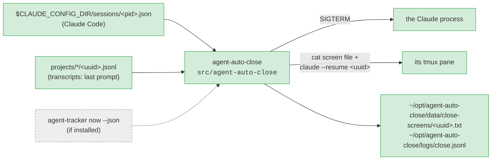

# agent-auto-close

**Close running Claude sessions to free memory, leaving each one resumable in its own tmux pane: by hand, or the ones idle for longer than N hours.**

## The big picture



<sub>green = live · dashed = planned (agent-tracker v1 is being built)</sub>

## The two commands

| Command | What it does |
|---|---|
| `agent-auto-close close <uuid \| uuid prefix \| %pane>` | closes one Claude session (was `asm close`) |
| `agent-auto-close idle --over <hours> [--dry-run]` | lists the Claude sessions that are idle and whose last prompt is older than `<hours>`, and closes them (`--dry-run`: only lists, with the safety checks' answer) |

A close, step by step:

```text
safety checks ──► capture the pane ──► SIGTERM ──► screen file ──► pane: cat screen file, then "claude --resume <uuid>" typed (press Enter to resume)
(refused: nothing touched)          (no exit in 5 s: stop, pane untouched)
```

**Scheduler: none yet.** When `idle` should run (every hour? at night? which N?) is not decided; for now it runs by hand.

## Folder map

```text
agent-auto-close/
├── AGENTS.md            rules for agents (Claude and Codex), vocabulary
├── README.md            this page
├── TESTING.md           how to run the tests
├── install.sh           → ~/opt/agent-auto-close/bin/agent-auto-close, link ~/.local/bin/agent-auto-close
├── uninstall.sh         removes both (keeps data/ and logs/)
├── src/agent-auto-close the command (Python 3, one file)
└── tests/
    ├── run_tests.sh     the tests, in a sandbox (own HOME, own tmux server)
    └── fake_claude.py   a fake Claude process the tests close
```

---
Rules for agents: [`AGENTS.md`](AGENTS.md)
